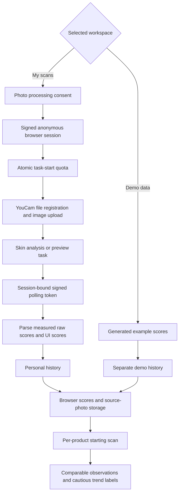

# Miren: YouCam cosmetic analysis and product matching

## Product

The shopper’s question is whether a product is working on their own face. Miren runs a YouCam Skin AI scan, matches the low scores to products, tries makeup on that photo, and compares a later scan. It also keeps saved products and habit check-ins. Look again after you start using something, and see if it shows up on your face.

A scan does not diagnose a condition or establish that a product caused a change. Catalog concern weights and matching thresholds are prototype heuristics. Skin simulation is an illustrative preview, not a product-outcome forecast.

## YouCam API map

All credentialed calls stay on the server.

| Step | Endpoint |
| --- | --- |
| Register source image | `POST /s2s/v2.0/file` |
| Upload image bytes | The returned presigned PUT URL and headers |
| Start skin analysis | `POST /s2s/v2.1/task/skin-analysis` |
| Poll analysis | `GET /s2s/v2.1/task/skin-analysis/{task_id}` |
| Start makeup preview | `POST /s2s/v2.0/task/makeup-vto` |
| Start skin simulation | `POST /s2s/v2.0/task/skin-simulation` |
| Poll preview | Corresponding task endpoint with the task ID |

HD and SD actions are kept separate. Moles and eyelid shape do not drive recommendations. UI scores are displayed; only measured raw scores enter longitudinal comparisons. The analysis profile is retained across asynchronous polling.

Makeup products use their colour payload. Skincare products use simulation intensities derived from catalog concern weights. Oiliness is omitted because the simulation slider adds shine.

Bearer API-key authentication is supported. An optional RSA public key enables the v1 token exchange, with a fallback to the v2 API-key bearer when that handshake is rejected. Invalid encryption keys are reported.

## Architecture

The source image is stored in IndexedDB for previews. A smaller thumbnail is used for display. Personal scans cannot receive generated follow-ups. API credentials, task ownership, quotas, and browser storage are described in README.md.

## Two-minute demonstration

1. **The question:** open the home screen. The line is whether this product is working on the shopper’s own face: Skin AI scan, matched products, try-on, re-scan.
2. **Live recording:** with credentials configured, leave the selector on My scans (the first-visit default). State that the selfie and makeup try-on are real YouCam calls. Without credentials, stay on Demo data, point at the single banner, and do not describe a render as live.
3. **Scan:** on Demo data, choose the sample photo (the same portrait as the home hero) and analyze. The Skin tab shows the annotated face, the overall verdict, and all concern scores.
4. **Matching:** open the For you tab and Nighttime Repair plus. Explain that the catalog weight is a matching heuristic.
5. **Preview:** on a makeup product, Try this on is the primary action. A live render shows before and after side by side. Demo data says the try-on did not run.
6. **Routine:** add the product to the cart and choose Start tracking. No payment occurs. Demo mode already shows an example baseline and follow-up. Generate demo follow-up still adds another labeled example. Causation is unknown.
7. **Separation:** switch to My scans and show that the demo history and routine are absent. Return to Demo data to restore them.
8. **Privacy:** show the data explanation and deletion control.

For a live recording, first configure the credentials and safeguards, obtain photo-processing consent, and verify real provider responses. Never narrate the fixture as a live API result.

## Verification boundaries

Automated coverage includes parser and matching rules, missing raw scores, comparison compatibility, timing guards, source-photo dimensions, live upload/task/poll contracts against simulated services, task ownership, quotas, data migration, baseline retention, browser persistence, mobile navigation, deletion, and automated accessibility checks.

A passing simulated-service test does not demonstrate provider entitlement, real image acceptance, a real rendered preview, deployment, or hackathon submission. Confirm those separately with authorized credentials and the actual destination.

## Capture suggestions

Use a 390 by 844 viewport for home, scan, results, product rationale, preview, routine, mode separation, and privacy. Keep the mode label visible. Do not crop away demo labels or qualify a simulation as a prediction.
