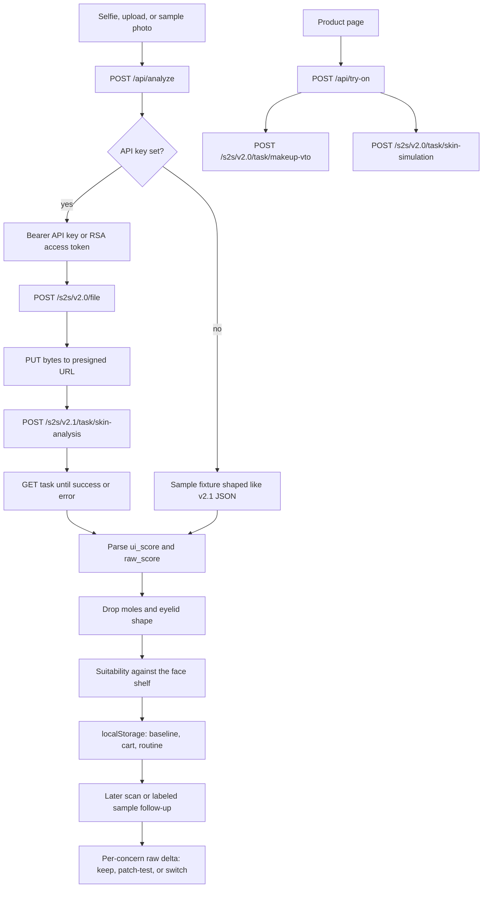

# GlowCheck — YouCam API Skin AI & eCommerce VTO

Hackathon: [YouCam API Skin AI & eCommerce VTO](https://youcam-api-skin-ai-ecommerce.devpost.com/)  
Deadline: 2 November 2026, 11:45am EST  
License: MIT (`LICENSE`)

## Problem

People do not wonder about their skin in the abstract. They wonder in two specific moments: standing in a shop (or a cart) deciding whether a product is for them, and a few weeks later staring at the same bottle wondering if it worked.

Most skin widgets stop at a score. GlowCheck uses that score to make the purchase decision, then uses a second scan to judge the product. The shelf is 175 products from Biologique Recherche, ZO Skin Health, and Circadia, with prices in ILS shown as ₪. Each face product carries YouCam concern tags and the original 0–1 scores. Those scores rank the matches. Results and the shop default show a short For you routine: at most eight unique products, led by concerns under 75, mixed by step, suits ahead of patch-test. Browse all opens the rest of the face catalog. Products with no concern data (body, hair, devices) do not appear in face recommendations. Keyword warnings in the product text are low confidence: they never produce a hard Skip on their own, and the note asks for a patch-test. A product photo loads only from an official brand HTTPS URL when one is mapped; otherwise a neutral placeholder. The product page does not link out to a shop.

Moles and eyelid shape are still filtered before any recommendation.

## YouCam APIs

All live calls are server-side. The browser never sees the API key or the RSA key.

### 1. AI Skin Analysis v2.1 — the scan

Used by `POST /api/analyze` and `GET /api/task?kind=skin-analysis`.

Documented flow, followed in `src/lib/youcam/client.ts`:

1. `POST https://yce-api-01.makeupar.com/s2s/v2.0/file` with `content_type`, `file_name`, and `file_size`.
2. `PUT` the exact bytes to `requests[0].url` with the returned headers. The file API alone does not upload the image.
3. `POST /s2s/v2.1/task/skin-analysis` with `src_file_id`, `format: "json"`, and `dst_actions`.
4. `GET /s2s/v2.1/task/skin-analysis/{task_id}` until `task_status` is `success` or `error`.

HD and SD actions are never mixed. Photos whose short side is at least 1080 pixels use HD actions and `miniserver_args.enable_mask_overlay`. Smaller photos (still at least 480 pixels) use the SD set. Eyelid actions are not requested. If the service returns a zip instead of JSON, the route downloads it and reads `score_info.json`.

Scores shown to the shopper are `ui_score`. Deltas in the routine use `raw_score`, which YouCam’s own docs say to store when comparing scans. Higher means healthier-looking skin.

### 2. AI Makeup Virtual Try-On — color products

Makeup try-on is `POST /s2s/v2.0/task/makeup-vto` with `version: "1.0"` and an `effects` array (lip colour, blush, foundation, or concealer, plus skin smooth set to 0), then `GET` until the result URL is ready. Six colour products from Rare Beauty, ILIA, Tower 28, and Kosas use that payload. Skincare products still use skin simulation. Sample mode returns the payload and the saved photo, with a makeup wash on the after side.

### 3. AI Skin Simulation — treatment previews

Used by `POST /api/try-on` for every product on this shelf. Intensities come from that product's concern scores, clamped between 0.2 and 0.6.

- `POST /s2s/v2.0/task/skin-simulation` with `src_file_id` and intensities from 0.0 to 1.0 (`wrinkle`, `pores`, `acne`, `spots`, `redness`, `radiance`, `texture`, `dark_circle`, `eye_bags`).
- `GET /s2s/v2.0/task/skin-simulation/{task_id}`.

The oiliness field is intentionally not sent. In the current docs, `1.0` **adds** shine. A mattifying or hydrating product must not be previewed by making the face oilier.

### Authentication

Current v2 quick start: `Authorization: Bearer <YOUCAM_API_KEY>`.

When `YOUCAM_PUBLIC_KEY` is set, GlowCheck also runs the v1 handshake from the YouCam docs:

- Encrypt `client_id=<API key>&timestamp=<milliseconds>` with the RSA X.509 public key, PKCS#1 v1.5, base64.
- `POST /s2s/v1.0/client/auth` with `{ client_id, id_token }`.
- If the server rejects the millisecond timestamp, retry once with a Unix timestamp in seconds (the docs show both).
- Use `result.access_token` as the bearer.
- If the handshake HTTP call fails, fall back to the v2 API-key bearer. A public key that cannot encrypt is a hard error, not a silent skip.
- A `401` on a v2 call that used the access token is retried once with the API key.

Sample mode is the default when `YOUCAM_API_KEY` is empty, and when `GLOWCHECK_FORCE_MOCK=1`.

## Architecture

State lives in the browser. The server holds no database and no photo archive. YouCam task ids are polled statelessly, because the task lives on YouCam’s side.

## Run and environment

See [README.md](README.md). Copy `.env.example` to `.env.local`. Leave the keys blank to demo sample mode.

## Screenshot shot list

Capture these for the Devpost gallery. Sample mode is enough for every frame. The sample face is an illustration, not a person.

1. Home, phone — “See what your skin actually needs.”, face oval, Take a selfie.
2. Home, returning — Last scan card and “Re-scan: is it working?”
3. Scan, empty — oval, upload, sample photo, analyze disabled until a photo is chosen.
4. Scan, sample photo selected — illustration in the oval, Analyze with YouCam ready.
5. Camera — dark screen, oval, lighting / face / makeup checks.
6. Results — large score, skin-score chip, mole and eyelid note, focus concerns, For you (at most eight products), and Beyond the shelf (top 3 habits).
7. Why sheet — one concern, plain language, raw score kept for follow-up.
8. Shelf — brand names, ₪ prices, Suits you / Patch-test / Skip chips. A keyword warning sits under the reason and does not flip a strong match to Skip.
9. Product — Nighttime Repair plus: catalog score, brand-site photo when mapped otherwise a neutral placeholder, search by brand and name, then the skin-simulation preview and payload.
10. Cart — Sérum Matriciel Visage skip banner inline, because firmness is already high. Checkout stays available. A pregnancy note on a matching product stays a footnote.
11. Routine — after “Load sample follow-up”, side-by-side photos and deltas. A line-and-pore product keeps. An acne-only score switches. Firmness-only stays a patch-test.

Suggested capture width: 390×844. The column maxes out at 440px on a wider window.

## Demo video script (about 2 minutes)

Say the product name and the API name out loud. Judges are not required to watch past three minutes.

**0:00 — The moment**  
“This is GlowCheck. The question is not ‘what is my skin score.’ It is ‘should I buy this, and did it work?’”

**0:15 — Scan**  
Open Scan, tap **Use the sample photo**, then **Analyze with YouCam**.  
“This selfie is sent to the YouCam AI Skin Analysis API, version 2.1. The server uploads it with the file API, starts a skin-analysis task, and polls until the scores are back. No key is in the browser.”

**0:40 — Results**  
“Each concern has a plain-language line. Higher means healthier-looking. Moles and eyelid shape are removed before we recommend anything — a cream on this shelf cannot treat them. The number you see is YouCam’s UI score. We keep the raw score for later.”

**1:00 — Suitability**  
Open Nighttime Repair plus.  
“Lines are the weak score on this scan, and the catalog scores this cream highly for wrinkles, so it suits. The pregnancy and sun notes come from keywords in the product text. They are low confidence, so the chip stays Suits you and the note says to patch-test. Sérum Matriciel Visage is a skip, because it only targets firmness and that score is already high. That check happens again in the cart.”

**1:20 — Try-on**  
On the same product, tap **Preview this match**.  
“This catalog’s products call YouCam AI Skin Simulation. The intensity comes from the product’s own 0–1 scores. Oiliness is never sent, because that slider adds shine. In sample mode you see the exact payload. With a key, the rendered photo comes back from YouCam.”

**1:40 — Is it working?**  
Add the cream, pass the cart check, then on Routine tap **Load sample follow-up**.  
“A second scan compares raw scores. Concerns this cream targets that moved up stay a keep. A product scored only for acne would switch, because that raw score drops on the sample follow-up. Under two weeks, a tiny move stays a patch-test.”

**2:00 — Close**  
“Same YouCam model a shopper meets before they pay, and again when they ask if the bottle earned its place.”

Do not use copyrighted music or third-party logos in the video.

## What was verified

Verified in this repo, without a YouCam account:

- Sample-mode `POST /api/analyze` returns a full scan and filters a mole.
- Parser covers the v2.1 JSON output shape and the nested `score_info.json` shape.
- Two different photos in sample mode produce different scores. The same bytes do not.
- Suitability on the sample scan: a product scored ≥0.85 for wrinkles suits; the same shape aimed only at mild acne is a patch-test; firmness-only is a skip. Keyword warnings do not turn a strong match into a skip. No scan stays a patch-test. Body, hair, and devices are absent from the face shelf (126 of 175 products are face matches).
- Sample follow-up: wrinkle and pore → keep, acne-only → switch, firmness-only → patch-test.
- RSA `id_token` decrypts to `client_id=…&timestamp=…`. Handshake retries seconds after a millisecond rejection, and falls back to the API-key bearer when auth is refused.
- Live client, against a fake YouCam: file POST, PUT, skin-analysis POST v2.1, GET poll, HD actions, no mole or eyelid action.

Not verified, because no YouCam credentials were available in this environment:

- A real file upload, task, and score payload from `yce-api-01.makeupar.com`.
- A real Makeup VTO or Skin Simulation image.
- RSA handshake acceptance against a live console secret (the retry and fallback are tested against a stub).
- A production Vercel deploy. The app is a standard Next.js project and is ready to import.

To verify live: put both env vars in `.env.local`, restart, and run a real selfie through Scan and a product preview. The header badge switches from “Sample mode” to “YouCam live”.
